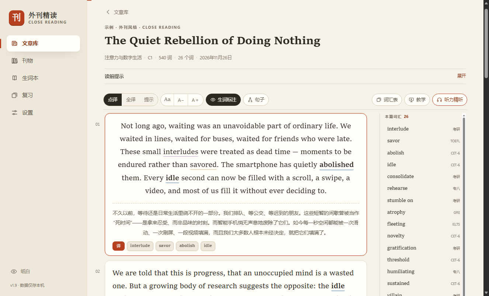
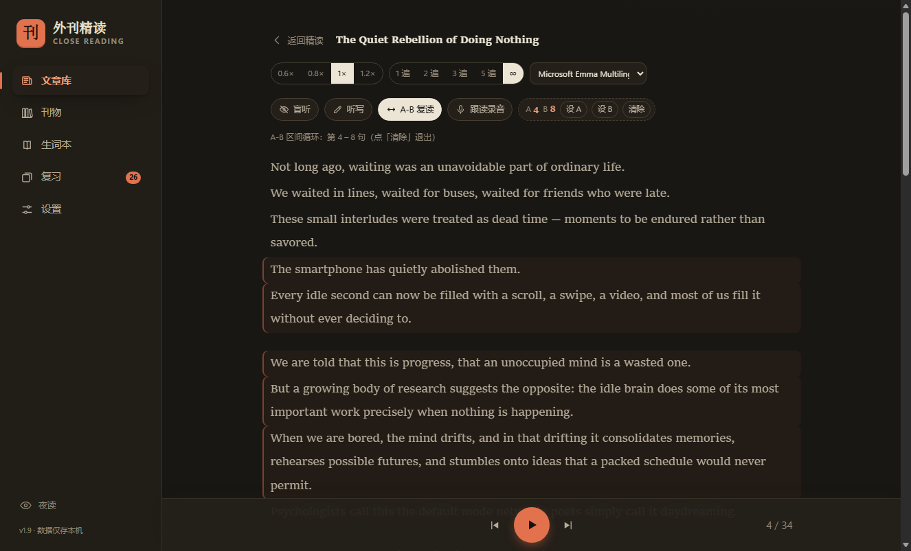
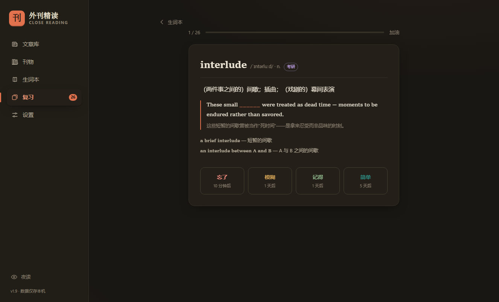
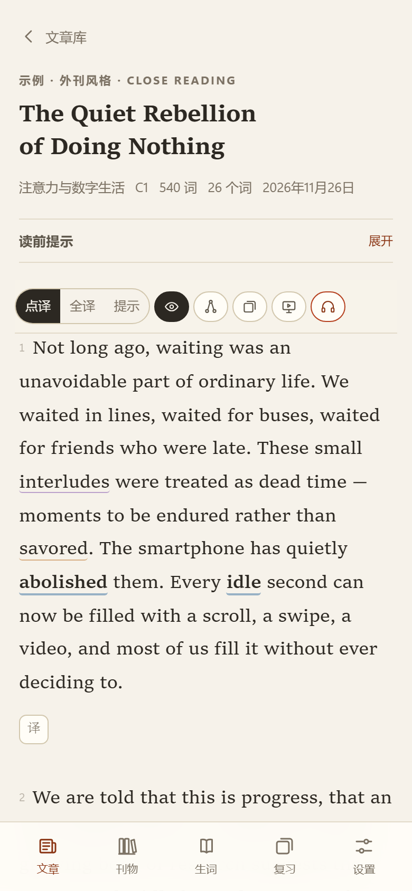

# 外刊精读 · Press Reader

碰到一篇想细读的英文文章，不用在原文、翻译、词典和生词本之间来回切换。把文章放进 Press Reader，先读英文，卡住了就点开这一段的译文；碰到想记的词，顺手收进生词本。读完还能用**同一篇文章**练听写，或者把刚遇到的词过一遍。



## 拿一篇文章试试

先到「文章库」点 **载入示例文章**。这篇是随项目附带的原创样文，已经有译文和生词标注，不用注册，也不用先申请 API Key。

- **读的时候**，可以把译文藏起来，只在读不懂的段落点开。点带下划线的词能看释义、例句和搭配，再决定要不要收录。
- **想练听力**，就切到「听力精听」。比如只循环第 4 到第 8 句，或者打开听写，写完一整句再看自己漏了哪些词。这里用的是系统或浏览器朗读，不是杂志的原版音频。
- **读完回头看**，可以马上复习本篇的标注词，也可以过几天做生词本里到期的闪卡。卡片还带着原文例句，不必只对着一个孤零零的单词猜意思。

想换成自己的文章，到「新文章精读」粘贴正文、填文章链接，或者从 RSS 里挑一篇。有些网站不允许自动抓取，能在浏览器里正常看到的正文，手动复制过来就行。要给自己的文章生成译文、标注生词或拆解长句，请在「设置 → AI 服务」填一个 OpenAI 兼容的接口地址、模型和自己的 API Key。AI 生成的内容用来辅助阅读，原文不会被改写。

| 逐句精听：只循环选中的几句 | 闪卡：带着原文例句复习 |
| --- | --- |
|  |  |

<details>
<summary>看看手机上的阅读界面</summary>
<br>

</details>

## 在自己电脑上跑

下载或克隆仓库，用终端进入项目目录。需要 **Node.js 22+**，不用跑 `npm install`：

```sh
npm start
```

浏览器通常会自动打开 `http://localhost:8123`；Windows 也可以直接双击 `start.cmd`。服务默认只在本机可用。在同一个可信 Wi‑Fi 下，想让手机连进来，可以运行 `npm start -- --lan`，再用手机打开终端显示的局域网地址。不要把本地服务暴露到公网。

文章、生词和复习进度保存在当前浏览器里；换设备前可以从「设置 → 数据」导出备份，备份不含 API Key。使用 AI 功能时，待分析的文字会发给你配置的服务商，Key 用于向该服务商认证。**仓库只带原创示例，不附送第三方刊物全文。**

## 构建和测试

- `npm run build`：生成单文件 `index.html`。直接打开也能读示例，但网页和 RSS 抓取需要先启动本地服务。
- `npm test`：运行单元测试和浏览器冒烟测试。需要 Chrome、Chromium 或 Edge；找不到浏览器时可用 `BROWSER_PATH` 指定。`npm run test:unit` 不需要浏览器或网络，`npm run test:feeds` 单独检查订阅源。
- `npm run apk`：构建 Android 测试 APK，输出到 `dist/`。需要 JDK 17+、Android SDK 的 `platforms/android-34` 和 Build Tools，并设置 `JAVA_HOME`、`ANDROID_HOME`。有设备和 Platform Tools 时，可用 `npm run apk:install -- --debug-webview` 安装测试包，再运行 `npm run test:android`。默认 APK 使用本地调试签名，不是正式发布包。

<details>
<summary>可选：在本地使用自己的刊物 EPUB</summary>

把可供本地使用的 The Atlantic EPUB 放进 `data/epub/`，运行 `npm run data:atlantic` 生成数据，再运行 `npm run build -- --with-atlantic`（Android 用 `npm run apk -- --with-atlantic`）。网页请用 `npm run serve` 打开，`npm start` 会重新生成不带刊物的默认版本。不要提交本地刊物数据，也不要分发含未获分发许可内容的产物。

</details>
